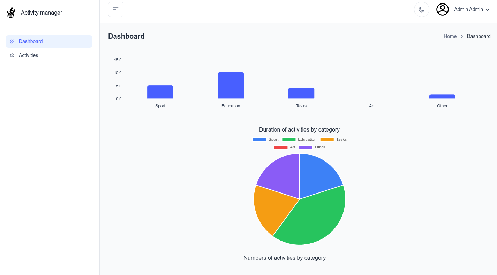
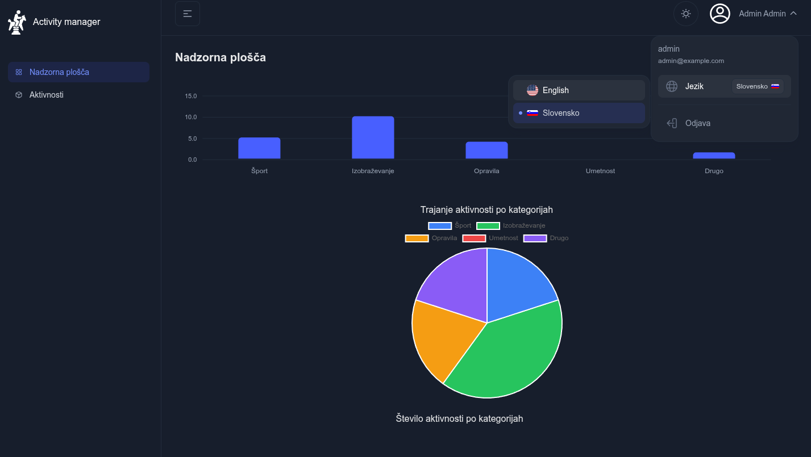
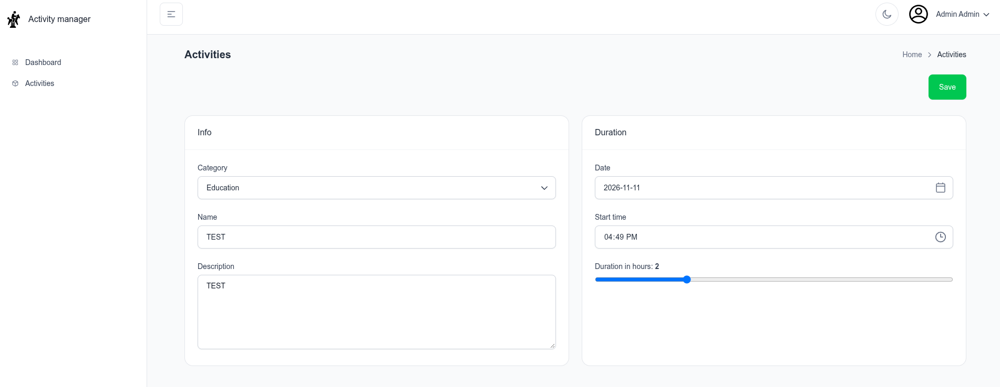
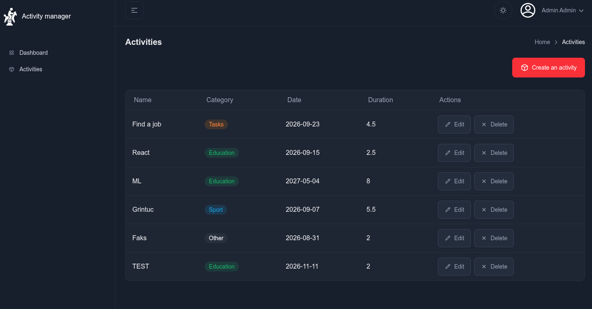

# Activity manager

## Project

The project enables CRUD operations for activities and basic statistics. Login is handled via Keycloak. User: `admin`, Pass: `test1234`. PostgreSQL was used for the database—credentials are the same as before. Application database name: `activities`. 

Architectural components:

| component | port |
| --- | --- |
| spring boot | 8081 |
| react | 5173 |
| postgres | 5432 | 
| keycloak | 8080 |


## Technical details

Versions: 

```text
│─┬java
│ ├──v21.0.7+6-tem
├─┬maven
│ └──v3.9.12
├─┬nodejs
│ ├──v24.8.0
```

*   Swagger was added for testing calls and generating API clients for the frontend. I used open api generator to generate the client using the following command:
    ```bash
    openapi-generator-cli generate -i http://localhost:8081/v3/api-docs/springdocDefault -g typescript-axios -o src/api-client --skip-validate-spec
    ```
*   Docker was used, only for the database and Keycloak.
*   The theme used was: `free-react-tailwind-admin-dashboard-main`. You can also find it [here](https://tailadmin.com/react). It allows light/dark theme switching, language changing, and has a basic set of free components. For the demo project, the free version was used. Language was configured for Slovenian and English.
*   `axios`: http client for frontend
*   `react-chartjs-2.js` was used for piecharts,
*   `dayjs` was used for date parsing,
*   `JHipster` microservice generator --> spring boot
*   `hibernate` for database management in Spring Boot
*   `postgres` for data storage
*   `keycloak` for identity manager / login / request validation
*   Added support for transactions in services: `@Transactional`. This ensures that if a transaction fails, a rollback is performed.
*   ...


## Instructions for running

Start the database and Keycloak using the `docker-compose.yaml` file. The database will not be persistent (in memory); the dump will be imported, which contains the entire configuration of the application and Keycloak. Use the following command:

```bash
docker compose up -d
```

*   SRV: Install dependencies: `mvn clean install package -DskipTests -Dmodernizer.skip -Dcheckstyle.skip=true`, run the main class, or you can use InteliJ. 
*   UI: Install dependencies: `npm install`, run app: `npx vite` or `npm run dev`.

Open web browser at: `http://localhost:5173`

# Screenshots










